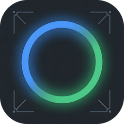

<div align="center">
  
  <h1>Glimpse · 瞬译</h1>
  <p><b>一瞥即译，无痕伴随</b> — 面向 Windows 的离线优先实时屏幕多区叠译、进程音频隔离同传与双向快捷输出工作台（v3.0）</p>
  <p>
    
    
    
    
  </p>
</div>

---

## 核心特性（v3.0）

* **防自捕透明叠层（`WDA_EXCLUDEFROMCAPTURE`）**
  基于 Windows DWM 原生截屏隔离（`0x11`），OCR 取景框与录屏软件会自动“无视”译文窗口本身。你可以放心地将翻译窗直接覆盖在外语字幕或原文上方，彻底消除自翻译死循环。
* **三种轻量交互模式随心切**
  * **常规浮窗模式**：主翻译底座与多路自由拆分的独立浮窗并存，支持点击穿透锁定。
  * **隐藏当前窗口（隐身热键）**：日常完全隐身不挡视野，按下全局热键（默认 `Alt+Q`，支持切换/按住两种手感）瞬间抓帧译出，位置可选“保持上次位置”或“自动吸附到取景框正上方”。
  * **原位无痕覆盖**：锁定区域后隐藏取景框，依据 OCR 像素坐标与底色采样在原文位置直接融合贴字、红线划除覆盖或半透条带覆盖。
* **全局控制 + 独立浮窗专属外观与高清描边**
  舍弃锯齿抠像，基于 `QPainterPath` 实现顺滑轮廓描边（`0–4 px`）。既能在「外观与窗口」统一调节全局面板底色/不透明度与译文/原文字号、字色、描边，也可为每一个拆分出来的独立浮窗开启**专属外观**，互不干扰。
* **单软件音频进程隔离 + 双向快翻胶囊**
  * 实时语音同传基于 Windows WASAPI 进程级环回（`ProcTap`）与声卡硬件环回，支持“点选屏幕窗口”只听指定游戏或播放器声音，屏蔽桌面其他杂音。
  * 按 `Alt+T`（文字）或 `Alt+V`（按住语音输入）随时呼出记忆位置的双向快翻胶囊，支持极简模式、独立窗口底色/透明度、游戏报点语气及自动复制剪贴板 / 自动粘贴回焦点输入框。
* **本地离线模型 & 云端 API 双引擎混合架构**
  * **本地零联网离线栈**：内置 `HY-MT1.5`（1.8B / 7B GGUF）与 `TranslateGemma-4B`，支持 NVIDIA CUDA、Vulkan 与纯 CPU 自动回退，以及 **游戏极速低占模式**；语音引擎兼容 `Faster-Whisper Large-v3-Turbo` 与纯 CPU `SenseVoice / Moonshine / Parakeet`。
  * **云端 OpenAI 兼容 API（0 显存）**：支持 DeepSeek（默认 `deepseek-flash`）、阿里云百炼（Qwen）、硅基流动、Google Gemini 与 OpenAI 兼容接口。

> **安全与游戏反作弊边界声明**：Glimpse（瞬译）的所有叠层、点击穿透与屏幕抓取均仅通过标准 Windows 桌面合成（DWM）与外部窗口句柄 API 实现，**不向任何游戏或第三方进程注入 DLL，不修改、不读取任何游戏内存**。游戏全屏叠加时建议将游戏显示设为「无边框窗口化（Borderless Window）」。

---

## 控制中心与工作流

* 启动软件默认打开**「控制中心」**主窗口，内置**模型预加载进度条**（全部加载完成前「开始翻译」按钮保持锁定保护）、一键 **5 项功能自检**、**记住上次窗口位置开关**与完整配置面板。
* 点击译文底座右上角 `×` **仅关闭翻译页面并暂停实时识别**（主程序保持就绪），可随时在控制中心再次点击「开始翻译」呼出；主窗口右上角提供**「最小化到任务栏」**与**「退出软件」**。

---

## 本地模型栈与系统要求

| 模块 | 默认 / 可选引擎 | 硬件加速 |
| :--- | :--- | :--- |
| **翻译推理** | `HY-MT1.5-1.8B` (Q8 / Q4) / `HY-MT1.5-7B` / `TranslateGemma-4B` / 云端 API | CUDA → Vulkan → CPU 自动探测 |
| **画面 OCR** | `RapidOCR PP-OCRv5` (4×2 分块帧差变化检测 + 可选「忽略纯中文画面」) | CPU 低占用高速推理 |
| **语音同传** | `Faster-Whisper Large-v3-Turbo` / `SenseVoice` / `Moonshine` / `Parakeet` | CUDA (`int8_float16`) / CPU (`int8`) |

* **系统要求**：Windows 10（2004 及以上，支持进程级音频隔离）或 Windows 11 64 位。
* **硬件建议**：推荐 NVIDIA RTX 独显（≥ 6GB 显存流畅全开）或任意现代多核 CPU + 8GB 内存（无独显可选纯 CPU 轻量化模型或接入云端 API）。

---

## 快速安装与使用

### 方式一：源码 / 轻量发行包一键安装（推荐）
1. 克隆本仓库或解压轻量包至任意本地目录。
2. 双击运行 **`一键安装运行.bat`**，向导将自动配置独立便携 Python 3.12 环境、依赖包（支持国内镜像自动回退）并拉取所需模型与 `llama.cpp` 运行时，完成后自动生成桌面快捷方式并启动 Glimpse。

### 方式二：开发者手动运行
```powershell
pip install -r requirements.txt
python setup_and_download.py
python app/main.py
```

---

## 目录结构

```text
Glimpse/
├── app/
│   ├── main.py                # 主控制器、启动预加载生命周期、全局热键与窗口协调
│   ├── config.py              # 全局配置、独立浮窗样式净化与 config.json 持久化
│   ├── dll_setup.py           # CUDA 运行库与 GPU/CPU 硬件环境探测
│   ├── llm_service.py         # 本地 llama-server 托管与云端 OpenAI 兼容并发翻译
│   ├── model_manager.py       # 本地 GGUF / Vulkan / ASR 目录、硬件评估与镜像下载器
│   ├── ocr_engine.py          # PP-OCRv5 多语识别、4×2 分块 MAD 检测与评论区结构化去噪
│   ├── asr_engine.py          # WASAPI 进程/声卡环形音频抓取、VAD 断句与语音识别
│   ├── process_audio.py       # 前台窗口拾取与进程树解析
│   ├── win32_utils.py         # WDA_EXCLUDEFROMCAPTURE、DWM 辅助、全局热键与粘贴模拟
│   └── ui/                    # Quiet Studio Slate（PySide6）主窗口、浮窗与平滑描边控件
├── assets/                    # 应用图标 AppIcon.ico / AppIcon.png 与矢量勾选资源
├── DESIGN.md                  # 客户端 UI 与交互设计规范
├── PRODUCT.md                 # 产品定位与核心架构说明
├── LICENSE                    # MIT 开源许可证
├── requirements.txt           # Python 依赖清单
├── setup_and_download.py      # 命令行模型与推理引擎预热脚本
├── 一键安装运行.bat            # 零前置环境一键初始化脚本
├── 启动翻译器.bat              # 无控制台窗口启动入口
├── 启动翻译器(调试日志).bat     # 带终端日志输出启动入口
└── 创建桌面快捷方式.bat        # 生成“Glimpse 瞬译”桌面快捷方式
```

---

## 开源许可

本项目采用 [MIT License](LICENSE) 开源发布。
